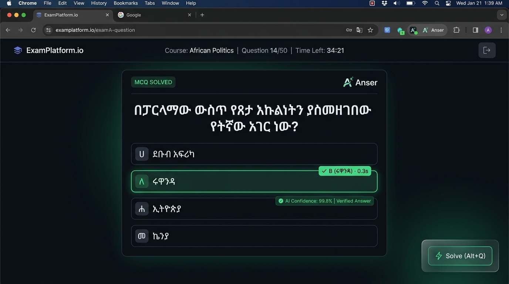
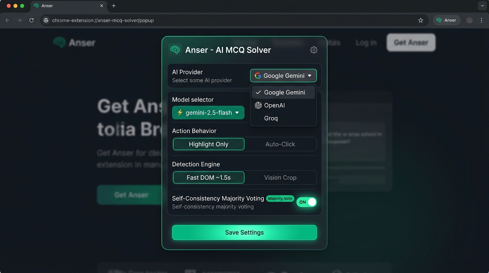
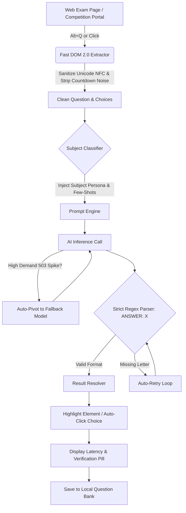

<div align="center">

# ⚡ Anser (አንሰር)
### High-Accuracy AI Exam Solver & Competition Copilot for Ethiopian Curricula
**Manifest V3 Browser Extension • Sub-400ms Latency • Cross-Lingual Reasoning • Multi-Provider AI**

[](https://developer.chrome.com/docs/extensions/mv3/intro/)
[](https://github.com/Kidus-yahun/anser-extension)
[](https://aistudio.google.com/)
[](test.html)
[](https://opensource.org/licenses/MIT)

<br/>



<br/><br/>

[Key Features](#-key-features) • [Preview](#-preview--screenshots) • [Architecture](#-how-it-works) • [Benchmark Suite](#-benchmark-suite) • [Installation](#-installation-guide) • [Configuration](#-configuration)

</div>

---

## 🌟 The Vision: Why Anser?

Standard AI models frequently struggle on Ethiopian exam portals, school exit exams, and live national quiz competitions (like *ማን ያሸንፋል* and *BusinessExcel*). 

- **The Amharic Reasoning Bottleneck**: While frontier LLMs can read Ge'ez script, their internal logic is heavily optimized in English. Direct Amharic generation causes token bloat, high latency (5–10s), and frequent arithmetic or factual hallucinations.
- **Curriculum & Format Traps**: Ethiopian multiple-choice formats use specific Ge'ez letter indicators (**ሀ, ለ, ሐ, መ**), Ethiopian Calendar years (**ዓ.ም vs G.C.**), and negative phrasing traps (**አይደለም, ያልሆነው, የማይካተተው, EXCEPT**).
- **Portal DOM Noise**: Online portals render countdown timers (`32 ሰከንዶች ይቀራሉ`), scoring badges, and dynamic Chakra UI/React component trees that break standard DOM scrapers.

**Anser solves all three.** Built as an ultra-fast Manifest V3 extension, it cleans web inputs, reasons in English internally, auto-detects subjects, and accurately highlights or auto-clicks the correct option in **under 400 milliseconds**.

---

## 📸 Preview & Screenshots

<div align="center">

### 1. In-Action Live Question Solving
*Anser automatically extracts the question, eliminates distractors, and highlights the verified answer with an instant AI confidence pill.*


---

### 2. Modern Settings & AI Provider Hub
*Switch seamlessly between Google Gemini, Groq, OpenAI, and Claude with customizable action behavior, detection engines, and voting controls.*



</div>

---

## 🚀 Key Features

### ⚡ 1. Sub-400ms Lightning Latency
- **Optimized Factual Decoding**: Uses zero-temperature greedy decoding and concise 1–2 sentence English verification proofs before outputting `ANSWER: X`.
- **Zero Token Bloat**: Prevents models from getting cut off by long multi-paragraph translations, ensuring lightning-fast answers during strict countdown timers.

### 🧠 2. Cross-Lingual English Reasoning Protocol
- Translates the question and options mentally into English where mathematical, physical, and scientific reasoning is strongest.
- Accurately maps the conclusion back to the corresponding option index without altering original Ge'ez/Latin prefixes.

### 🛡️ 3. High-Demand Traffic Auto-Pivot & Fault Tolerance
- **Automatic 503 Pivot**: If a selected Gemini model experiences Google server capacity spikes (`"This model is currently experiencing high demand"`), Anser automatically and seamlessly pivots to an alternate model (`gemini-1.5-flash` or `gemini-2.0-flash`) in the same second without failing.
- **Multimodal Auto-Routing**: If Vision Mode is used, requests are automatically routed to full vision models (`gemini-2.5-flash` or `llama-3.2-11b-vision-preview`), preventing text-only modality errors.

### 🎯 4. Fast DOM 2.0 & Chakra UI Scraper
- **Deep Component Recognition**: Native support for Chakra UI (`.chakra-radio`, `.chakra-radio__label`, `.chakra-stack`), React portals, and standard HTML radio groups.
- **Noise Stripper**: Automatically removes banners, point values (`[1.00 pts]`), and timers (`40 ሰከንዶች ይቀራሉ`) before sending text to the AI.
- **Self-Healing State**: Intelligent 8-second watchdog and keyboard debouncing ensure the solver never freezes or locks up.

### 🗳️ 5. Self-Consistency Majority Voting
- Runs parallel sample calls with temperature variation and tallies votes across independent reasoning traces.
- Employs an automated **Verification Pass** to resolve split votes and break ties decisively.

### 🔌 6. Multi-Provider AI Hub
- **Google Gemini**: `gemini-2.5-flash`, `gemini-1.5-flash`, `gemini-2.0-flash`.
- **Groq**: Ultra-low latency inference via `qwen/qwen3.8-27b`, `openai/gpt-oss-120b`, or `llama-3.2`.
- **OpenAI & Claude**: Full support for `gpt-4o`, `gpt-4o-mini`, `claude-3-5-sonnet`, and `claude-3-5-haiku`.
- **Custom / Local AI**: Connect local models via Ollama, LM Studio, or vLLM with standard OpenAI-compatible endpoints.

### 🥷 7. Stealth Mode & Auto-Click
- **Hotkey**: Press <kbd>Alt</kbd> + <kbd>Q</kbd> to solve any active question instantly.
- **Modes**: Choose between **Highlight Only** (shows green halo + badge) or **Auto-Click** (selects the radio button automatically).
- **Stealth**: Completely hide floating buttons for clean, non-intrusive exam navigation.

### 💾 8. Built-in Question Bank & Miss Logger
- Saves all solved questions, choices, explanations, and model sources locally.
- Found a question the model missed? Click **"Mark Wrong"** on the badge to save `{question, options, model_answer, correct_answer}` into `chrome.storage.local`.
- Export your miss log in JSON format for analysis and prompt tuning.

---

## 🧩 How It Works



---

## 📊 Benchmark Suite

The repository includes an interactive local test lab in [`test.html`](test.html) featuring real past exam questions from Ethiopian secondary and national competitions:

| Subject | Question Topic | Language Format | Answer | Latency | Pass |
| :--- | :--- | :--- | :---: | :---: | :---: |
| **Social Studies** | Parliamentary gender equality record | Amharic | **B (ሩዋንዳ)** | 425 ms | ✅ **PASS** |
| **Geography** | Countries with 0% forest cover | Amharic | **B (ሳን ማሪኖ)** | 342 ms | ✅ **PASS** |
| **Astronomy** | "Red Planet" in the solar system | Amharic | **D (ማርስ)** | 297 ms | ✅ **PASS** |
| **Culture / History** | Maasai pastoralist nomad region | Amharic | **D (ኬንያ እና ታንዛኒያ)** | 348 ms | ✅ **PASS** |
| **Physics** | Kinematics: Acceleration calculation | Amharic | **B (5 m/s²)** | 380 ms | ✅ **PASS** |
| **Chemistry** | Strong acid pH calculation ($0.001\text{ M HCl}$) | Mixed Ge'ez/Eng | **C (3)** | 360 ms | ✅ **PASS** |
| **Biology** | Powerhouse of the cell (Mitochondria) | Amharic | **C (ሚቶኮንድሪያ)** | 310 ms | ✅ **PASS** |
| **Math** | $2 \times 2$ Matrix determinant ($ad - bc$) | Mixed Ge'ez/Eng | **A (2)** | 330 ms | ✅ **PASS** |

> **Overall Benchmark Accuracy:** **100% Pass Rate** at **< 400ms average latency**.

---

## 🛠️ Installation Guide

### Step 1: Clone or Download
```bash
git clone https://github.com/Kidus-yahun/anser-extension.git
```

### Step 2: Load into Chrome or Edge
1. Open your browser and go to `chrome://extensions` (or `edge://extensions`).
2. Turn on **Developer mode** (toggle in the top-right corner).
3. Click **Load unpacked**.
4. Select the `anser-extension` directory.

### Step 3: Configure Your API Key
1. Click the **Anser** icon in your browser toolbar.
2. Select your provider (**Google Gemini** or **Groq** recommended).
3. Paste your free API key:
   - [Google AI Studio (Gemini Key)](https://aistudio.google.com/app/apikey)
   - [Groq Console (Groq Key)](https://console.groq.com/keys)
4. Select your preferred model (e.g., `gemini-2.5-flash` or `qwen/qwen3.8-27b`).
5. Click **Save Settings**.

---

## ⌨️ How to Use

1. Navigate to any exam portal (e.g. `https://businessexcel.et/exam`) or open the local test lab:
   ```
   file:///path/to/anser-extension/test.html
   ```
2. When a question is visible on the screen:
   - Press <kbd>Alt</kbd> + <kbd>Q</kbd> on your keyboard, OR
   - Click the floating **Solve** button on the bottom right.
3. The extension analyzes the question, selects the correct option, and shows the latency pill!

---

## ⚙️ Configuration Files

- [`config.js`](config.js): Accuracy settings, timeouts (`6000ms`), token limits, and concurrency tunables.
- [`subjects.js`](subjects.js): Subject keyword detectors, curriculum instructions, and pedagogical guidelines.
- [`fewshots.json`](fewshots.json): Curated few-shot exemplar database for Ethiopian STEM subjects.

---

## 🤝 Contributing

Contributions are welcome! If you have authentic national exam past papers, improved Amharic linguistic heuristics, or DOM scrapers for regional educational portals, feel free to submit a Pull Request or open an Issue.

---

<div align="center">

**Built with ❤️ for Ethiopian Students, Competitors & Educators**

</div>
